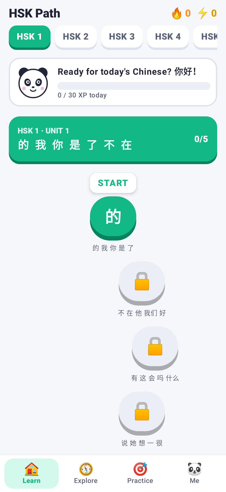
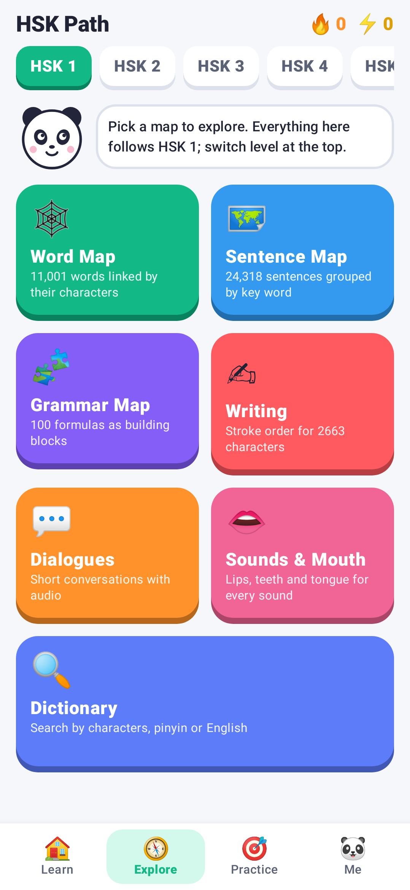
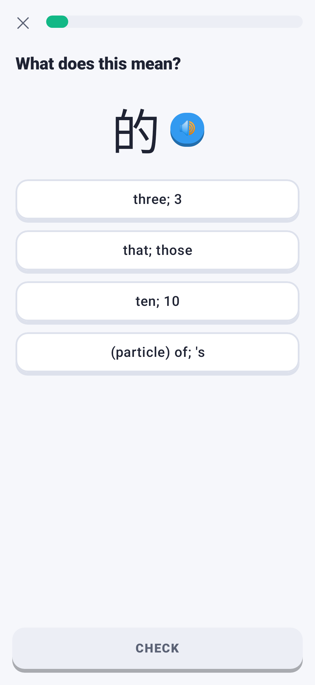
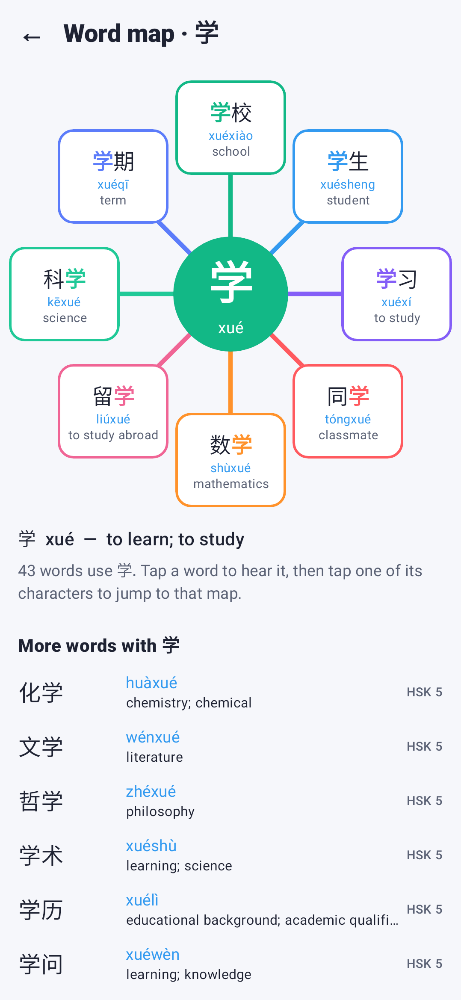
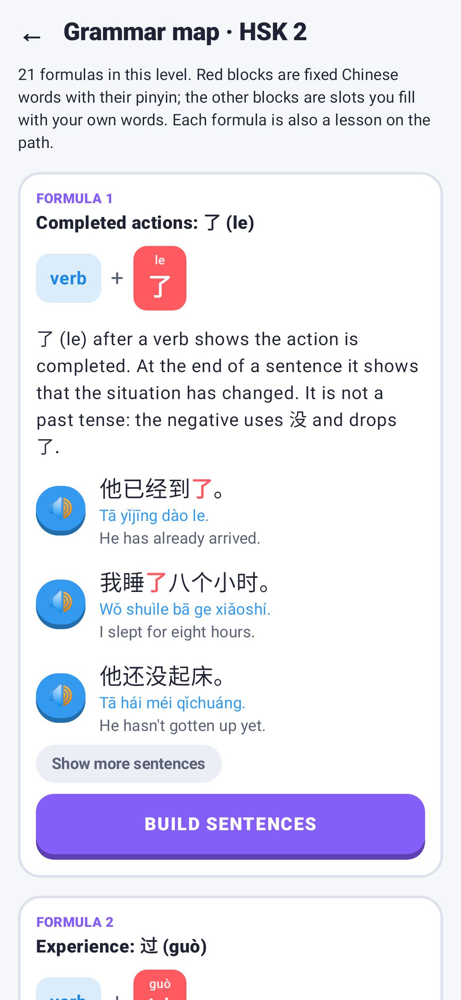
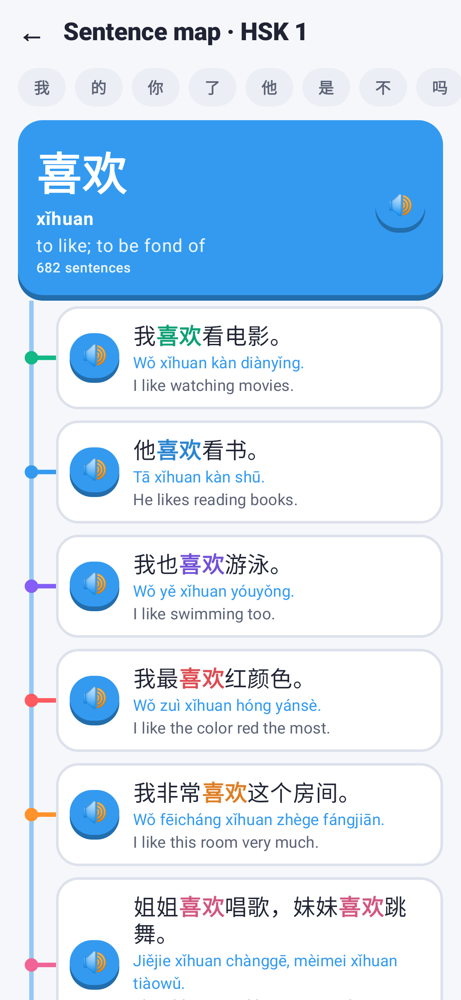
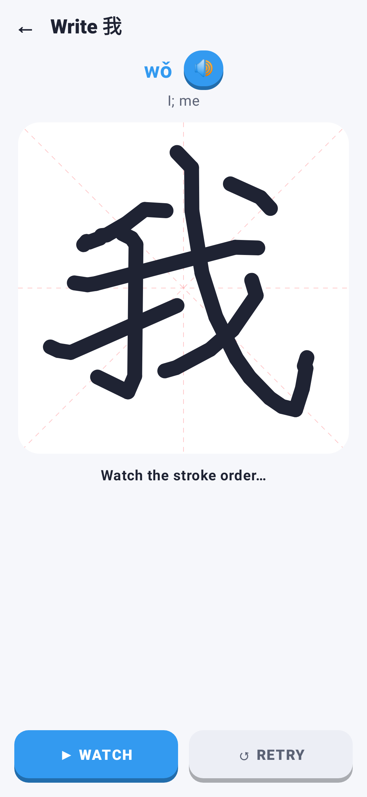
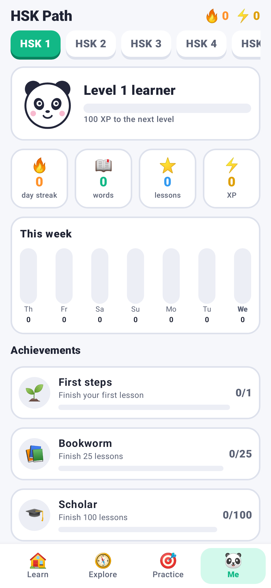
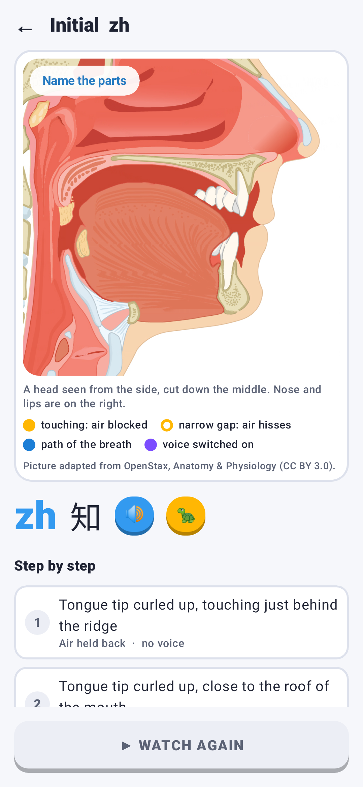
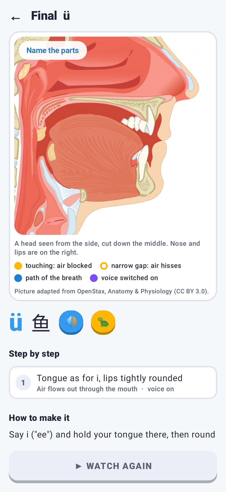

# HSK Path

An offline Android app for learning Mandarin Chinese through the six HSK levels,
in short game-like lessons.

## What is in it

| Part | What you get |
| --- | --- |
| Learning path | All 5,001 words of HSK 1-6 in units. Each unit mixes vocabulary lessons of five words with grammar lessons and ends in a review; a level test lets you jump ahead. HSK 1 is arranged in themed units (Hello, People, Family, Numbers, ...) with each grammar formula placed after the words it uses; levels without an outline file follow word frequency |
| Lessons | A new word is introduced with audio, meaning, its characters and examples, then drilled: meaning, characters, pinyin and tones, listening, pair matching, fill-the-gap and sentence building. A grammar lesson shows the formula as blocks with examples, then has you pick its key word and read and build sentences. Missed questions come back at the end. Pinyin above the characters can be switched on or off |
| Word Map | 11,001 words (HSK plus 6,000 common everyday words) linked by their characters: a character sits in the middle and the words built from it branch out |
| Sentence Map | About 24,300 sentences with pinyin and English, grouped by key word and graded by HSK level |
| Grammar Map | 100 formulas drawn as colour-coded building blocks, each with an explanation, examples pulled from the corpus and a sentence-building drill |
| Writing | Stroke-order animation and stroke-by-stroke tracing for all 2,663 characters in HSK 1-6 |
| Phrase books | 900 phrases with audio and drills: 500 everyday phrases in 20 topics, 100 travel phrases in 10 topics, 300 business phrases in 12 topics |
| Training plans | A day-by-day schedule through each level (HSK 1-3 in 30 days each, HSK 4 in 60, HSK 5 in 100, HSK 6 in 150): lessons, a grammar formula, a sentence workout and optional handwriting each day, ending with the level test |
| Dialogues | 17 short conversations covering every level, with line-by-line audio and "play all" |
| Sounds and mouth positions | For all 21 initials and 35 finals: a real textbook picture of the head in side section that moves — jaw, lips, tongue and soft palate — played step by step (closure, release, vowel) with the breath through mouth or nose, the puff of aspirated sounds and voicing marked; a button that names the parts; instructions, the nearest English sound and practice words; plus the tones with pitch contours and tone-change rules |
| Practice | Spaced-repetition word review, sentence workouts (translate, listen, build), grammar drills, and a 30-question test per level |
| Dictionary | Search all 11,001 words by characters, pinyin (tones optional) or English |
| Motivation | XP, ranks, a daily goal, day streaks, a weekly chart, 13 achievements, and a panda that cheers you on |

Pronunciation uses the phone's own text-to-speech voice, so a Chinese voice must be
installed (Settings → Accessibility → Text-to-speech). The app says so if it is missing.

## Building

Open the folder in Android Studio, or run:

```
./gradlew :app:assembleDebug     # APK in app/build/outputs/apk/debug/
./gradlew :core:test             # logic and content tests
./gradlew :app:testDebugUnitTest # renders every screen (add -Pscreenshots to save PNGs to app/build/screens)
```

Every push also builds the APK on GitHub Actions; download it from the run's
"hsk-path-debug-apk" artifact.

## Layout

- `core/` — plain Kotlin, no Android: content parsing, pinyin, lesson and exercise
  generation, sessions, spaced repetition, stroke matching, achievements and progress.
  Its unit tests run against the real lesson data. `./gradlew -PcoreOnly :core:test`
  runs them without the Android SDK.
- `app/` — the Jetpack Compose interface, text-to-speech and saved progress.
- `app/src/main/assets/` — the lesson data as plain text: word lists, sentences,
  grammar, dialogues, phrase books, course outlines, strokes and mouth diagrams.
  Edit `content/` by hand to add or correct material; `content/outline_hsk<N>.txt`
  sets the units, their themes and where grammar lessons go
  (`python3 tools/check_outline.py <N> <file>` checks one).
- `tools/` — scripts that regenerate the word lists, sentence corpus, stroke data and
  mouth diagrams from the open sources below (`tools/mouth/SPEC.md` describes the
  mouth diagrams).

## Content sources and licences

- Word lists: the published HSK 2.0 lists (levels 1-6), via the
  [chinese-lexicon](https://www.npmjs.com/package/chinese-lexicon) package (ISC).
  Words beyond HSK are ranked by SUBTLEX-CH film-subtitle frequency.
- Definitions and readings: [CC-CEDICT](https://cc-cedict.org/), licensed
  [CC BY-SA 4.0](https://creativecommons.org/licenses/by-sa/4.0/). The files in
  `app/src/main/assets/words/` are derived from it and carry the same licence.
- Sentence corpus (`app/src/main/assets/sentences/`): [Tatoeba](https://tatoeba.org),
  licensed [CC BY 2.0 FR](https://creativecommons.org/licenses/by/2.0/fr/). Word
  splitting and pinyin were added automatically and can contain occasional mistakes.
- Stroke order (`app/src/main/assets/strokes.tsv`): derived from
  [Hanzi Writer data](https://github.com/chanind/hanzi-writer-data), built on Make Me
  a Hanzi and the Arphic fonts; see `licenses/ARPHICPL.TXT`.
- Mouth diagrams (`app/src/main/assets/mouth/`, `mouth.json`): adapted from the figure
  "Anatomy of Nose-Pharynx-Mouth-Larynx" by OpenStax College, *Anatomy & Physiology*
  (Connexions, http://cnx.org/content/col11496/1.6/), licensed
  [CC BY 3.0](https://creativecommons.org/licenses/by/3.0/), via
  [Wikimedia Commons](https://commons.wikimedia.org/wiki/File:2303_Anatomy_of_Nose-Pharynx-Mouth-Larynx.jpg).
  Changes: labels removed, cropped, and the tongue, lower jaw and soft palate cut out
  and moved to show each sound (`tools/mouth/source/README.md`). The adapted pictures
  carry the same licence.
- Beginner glosses for HSK 1-2, about 215 hand-written example sentences, the grammar
  formulas, the phrase books and the dialogues were written for this app.

The app is independent. It is not affiliated with any textbook publisher or with the
organisations that run the HSK exam, and it contains no material from commercial books.

## Screens

| Learn | Explore | Lesson | Word Map |
| --- | --- | --- | --- |
|  |  |  |  |

| Grammar Map | Sentence Map | Writing | Profile |
| --- | --- | --- | --- |
|  |  |  |  |

| Mouth position (zh) | Mouth position (ü) |
| --- | --- |
|  |  |
